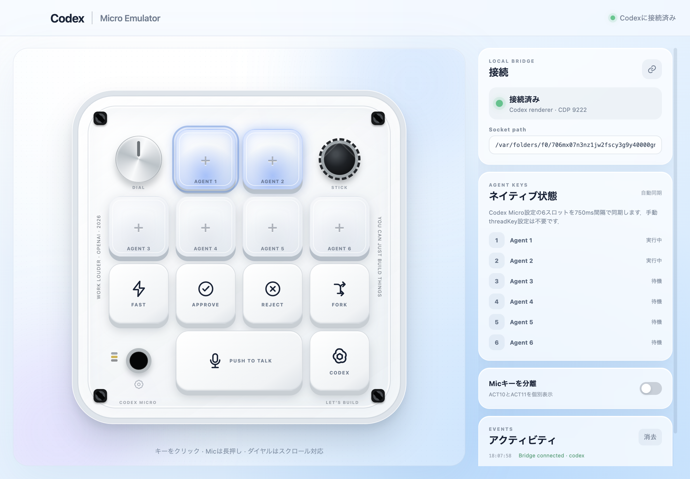

# codex-micro-emulator

[](https://github.com/Hietan/codex-micro-emulator/actions/workflows/ci.yml)
[](https://github.com/Hietan/codex-micro-emulator/releases)
[](LICENSE)

**Current release: v0.1.0**

Codex Microの実機配列を画面上に再現し，ローカルの`codex-micro-bridge`へ入力イベントを送るElectronデスクトップアプリです．通常のキーボードショートカットを使わないため，Codexが前面にない状態でも操作できます．



> [!WARNING]
> このアプリが接続するBridgeは，ChatGPT Desktopの非公開rendererイベントを利用する実験実装です．ChatGPT Desktopの更新により動作しなくなる可能性があります．

## 配列

公式実機と同じ4列構成です．

```text
┌────────┬────────┬────────┬────────┐
│ Dial   │ Agent1 │ Agent2 │ Stick  │
├────────┼────────┼────────┼────────┤
│ Agent3 │ Agent4 │ Agent5 │ Agent6 │
├────────┼────────┼────────┼────────┤
│ Fast   │ Approve│ Reject │ Fork   │
├────────┼────────┴────────┼────────┤
│ Config │ Push to talk    │ Codex  │
└────────┴─────────────────┴────────┘
```

## 現在できること

- ACT06〜ACT09とACT12のtap
- ACT10のpush-to-talk press／release
- Separate Mic設定時のACT10／ACT11個別操作
- ENCの押下，ENC_CW／ENC_CCの回転
- ジョイスティック4方向のpress／release
- AG00〜AG05のCodex Micro設定からの自動割り当てとtap
- 6 Agentの未割当・待機・実行中・完了未読・入力待ち・エラー・選択状態
- BridgeとAgent状態の750ms自動同期
- Socket pathのローカル保存
- ウィンドウがフォーカスを失った場合の保持キー強制release
- Mock Bridgeを使った安全なUIテスト

Agentキーの色と選択枠はCodexのネイティブ6スロット状態を示します。Bridgeの
`snapshot`応答はtask IDやタイトル、プロンプト、応答本文をUIへ渡しません。

## 必要環境

- Node.js 22.4以降
- pnpm
- 隣接する`codex-micro-bridge`リポジトリ

両方のリポジトリを同じ親ディレクトリへcloneします：

```bash
git clone https://github.com/Hietan/codex-micro-bridge.git
git clone https://github.com/Hietan/codex-micro-emulator.git
```

## セットアップ

```bash
cd codex-micro-emulator
corepack enable
pnpm install --frozen-lockfile
pnpm build
```

v0.1.0はソース配布です。署名・公証済みのDMGはまだ提供していません。

## Mockモードで起動

ターミナル1でBridgeを起動します．

```bash
cd ../codex-micro-bridge
pnpm build
node dist/src/cli.js start --mock
```

ターミナル2でデスクトップアプリを起動します．

```bash
cd ../codex-micro-emulator
pnpm dev
```

右上が`Mock Bridge`になれば接続済みです．キーを操作するとBridge側のログにイベントが表示されます．

## 実際のCodexへ接続

ChatGPT DesktopをCDP付きで起動し，Bridgeを常駐させてからアプリを開きます．詳細は隣のBridgeリポジトリのREADMEを参照してください．

```bash
cd ../codex-micro-bridge
node dist/src/cli.js start --port 9222
```

別ターミナル：

```bash
cd ../codex-micro-emulator
pnpm dev
```

## 操作

- Command Key：クリックでpressとreleaseを送信
- Mic：押している間ACT10を保持し，離すとrelease
- Dial：クリックでENC，スクロールまたは左右ボタンでENC_CW／ENC_CC
- Joystick：方向部分を押している間`distance: 1`，離すと`distance: 0`
- Agent Key：クリックするとBridgeがCodex Micro設定の現在スロットを解決して送信．ダブルクリックするとnative handlerへ短い間隔で2回tapを送る
- 左下の黒いタッチ部：右側のBridge設定へフォーカス

## 開発コマンド

```bash
pnpm check
pnpm test
pnpm build
pnpm screenshot
```

## セキュリティ

RendererではNode.jsを無効化し，`contextIsolation`とsandboxを有効にしています．Preloadから公開するのはallowlist検証済みBridgeリクエスト，デフォルトsocket path，アプリバージョンだけです．任意JavaScriptや任意Codexコマンドは送信できません．詳細は[`SECURITY.md`](SECURITY.md)を参照してください．

## 参照

- [Codex Micro公式ドキュメント](https://learn.chatgpt.com/docs/features/codex-micro)
- [OpenAI Supply Co. x Work Louder](https://openai.com/supply/co-lab/work-louder/)
- [Work Louder Codex Micro](https://worklouder.cc/codex-micro)

## 関連プロジェクト

- [Codex Micro Bridge](https://github.com/Hietan/codex-micro-bridge)
- [Codex Control for QMK](https://github.com/Hietan/hifumi-codex-qmk)

不具合報告は[Issueフォーム](https://github.com/Hietan/codex-micro-emulator/issues/new/choose)、
脆弱性はGitHubのprivate vulnerability reportingから報告してください。

## ライセンスと商標

本アプリはMIT Licenseです。本プロジェクトはOpenAIの公式製品ではありません。
OpenAI、Codex、ChatGPTおよび各商標はそれぞれの権利者に帰属します。公式の
キーキャップ画像や製品アートワークは同梱していません。
